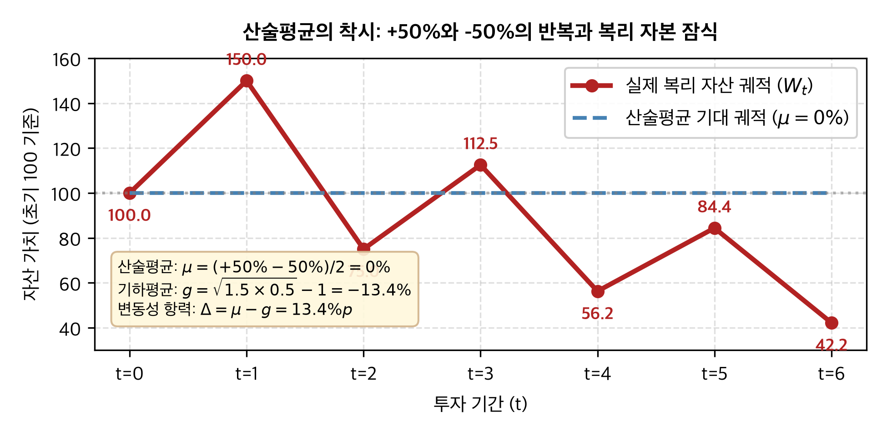
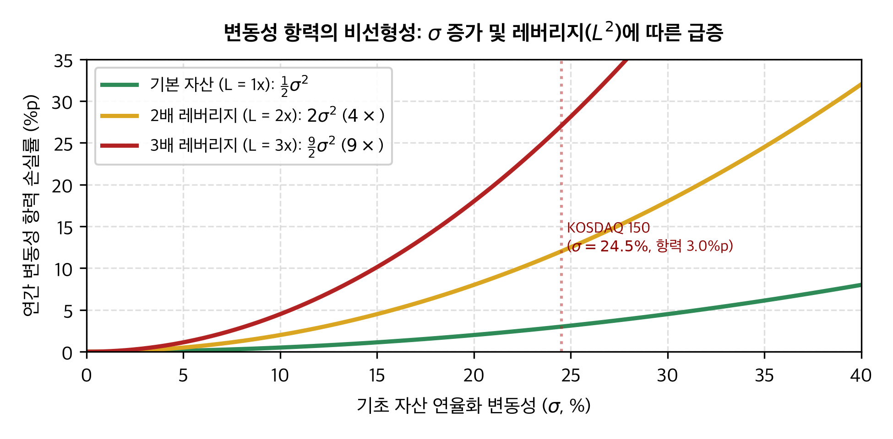
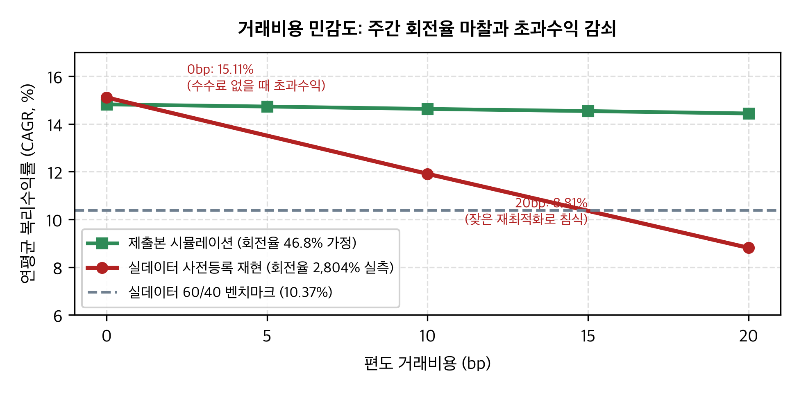
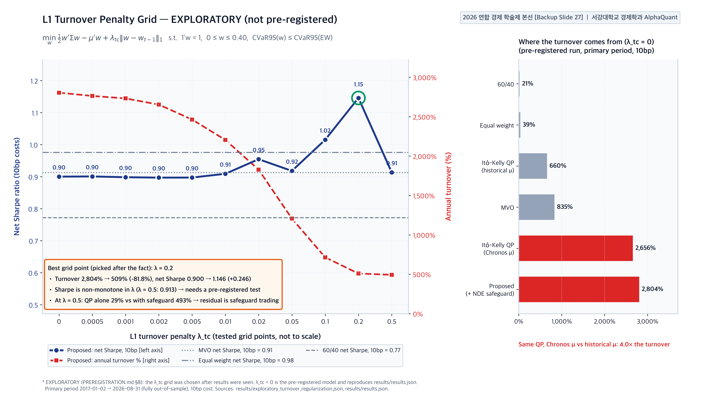

# 이토 보조정리 × TSFM 동적 자산배분: 변동성 항력(Volatility Drag) 제어 프레임워크
> **Itô's Lemma × Time-Series Foundation Models for Dynamic Asset Allocation and Volatility Drag Mitigation**

[](https://github.com/PJH720/alphaquant-tsfm-voldrag)
[](https://econ.sogang.ac.kr/)
[](https://python.org)
[](LICENSE)
[-4285F4?style=for-the-badge&logo=googledrive&logoColor=white)](https://drive.google.com/file/d/1WZzcCbN3eu82t1ncEctKWJ_VqR8GhlLW/view?usp=sharing)
[-0F9D58?style=for-the-badge&logo=googledrive&logoColor=white)](https://drive.google.com/file/d/19fN7rLw76XGthML_M3ARB8wZMfzs_1w9/view?usp=sharing)
[](https://alphaquant-voldrag-demo.vercel.app)
[](https://github.com/PJH720/alphaquant-tsfm-voldrag-empirical)

---

### 2026 연합 경제 학술제 (서강대학교 · 성균관대학교 · 이화여자대학교) 출품 논문 및 공식 연구 저장소

* **팀 알파퀀트 (서강대학교 경제학과)**
  * **박재현** (대표, 연구총괄 · 모델링 및 파이프라인 엔지니어링, `pjhlemont@gmail.com`)
  * **강명서** (본선 발표 · 정성적 정책 분석)
* **논문 원제**: 『이토 보조정리와 시계열 파운데이션 모델(TSFM)을 결합한 동적 자산배분 및 변동성 항력(Volatility Drag) 제어 프레임워크: 산업 비파괴검사 기반 비지도 꼬리위험 세이프가드를 중심으로』

---

> [!IMPORTANT]
> ### 🎯 학술제 본선 공식 발표자료 슬라이드 열람 (Google Drive)
> **2026 연합 경제 학술제 본선 발표용 공식 슬라이드(16:9 와이드, 27쪽, 벡터 도식 및 고화질 차트 집약본)** 원본 PDF를 구글 드라이브에서 즉시 열람 및 다운로드하실 수 있습니다:  
> 🔗 **공식 발표 슬라이드 열람**: [**[서강대]_알파퀀트_발표자료.pdf (Google Drive)**](https://drive.google.com/file/d/1WZzcCbN3eu82t1ncEctKWJ_VqR8GhlLW/view?usp=sharing)  
> *(참고: 31쪽 소논문 최종 심사 제출본 PDF는 [여기 Google Drive](https://drive.google.com/file/d/19fN7rLw76XGthML_M3ARB8wZMfzs_1w9/view?usp=sharing)에서 열람하실 수 있습니다.)*

---

## 📌 핵심 공개 링크 (Quick Links)

| 자료 구분 | 링크 | 설명 |
|---|---|---|
| 🎯 **본선 발표 슬라이드 (PDF)** | [**[서강대]_알파퀀트_발표자료.pdf** (Google Drive)](https://drive.google.com/file/d/1WZzcCbN3eu82t1ncEctKWJ_VqR8GhlLW/view?usp=sharing) | **[추천]** Google Drive 공식 본선 발표 슬라이드 (27쪽, 16:9 이미지·차트 집약본) |
| 📥 **소논문 심사 최종본 (PDF)** | [**(수정본) Final_Paper(version-2-New).pdf** (Google Drive)](https://drive.google.com/file/d/19fN7rLw76XGthML_M3ARB8wZMfzs_1w9/view?usp=sharing) | Google Drive 공식 심사 제출본 논문 원문 (31쪽, 최종 조판 서식) |
| 🌐 **시연 데모 웹** | [alphaquant-voldrag-demo.vercel.app](https://alphaquant-voldrag-demo.vercel.app) | 제출본 시뮬레이션 및 실데이터 재현 인터랙티브 대시보드 |
| 🧪 **실데이터 재현 저장소** | [`PJH720/alphaquant-tsfm-voldrag-empirical`](https://github.com/PJH720/alphaquant-tsfm-voldrag-empirical) | 실제 시장 데이터 기반 사전등록(Pre-registration) 검증 저장소 |

---

## 1. 연구 배경 및 핵심 아이디어

장기 다기간(Multi-period) 투자에서 자산 증식을 지배하는 것은 단일기간 산술평균 $\mu$가 아니라 **실제 실현 복리 기하성장률 $g$**입니다. 

기하 브라운 운동(GBM) $dS_t = \mu S_t dt + \sigma S_t dB_t$ 에 이토 보조정리(Itô's Lemma)를 적용하면:

$$d(\ln S_t) = \left(\mu - \frac{1}{2}\sigma^2\right)dt + \sigma dB_t$$

로그 수익률의 실질 드리프트는 $\mu$가 아닌 **$g = \mu - \frac{1}{2}\sigma^2$** 로 감쇄합니다. 이때 발생하는 괴리인 **변동성 항력(Volatility Drag, $\Delta = \frac{1}{2}\sigma^2$)**은 변동성의 제곱($\sigma^2$) 및 레버리지 배율의 제곱($L^2$)에 비례하여 기하급수적으로 폭증합니다.

<p align="center">
  
  
</p>

1. **산술평균의 함정 (+50%와 -50%의 반복)**: 산술평균은 $0\%$이지만 6기 후 원금은 $100 \to 42.2$로 $-57.8\%$ 침식됩니다 (기하평균 $g = -13.4\%$, 항력 $13.4\%p$).
2. **단일기간 평균-분산 모형(MVO)의 한계**: MVO는 분산의 복리 침식 항을 직접 목적함수에서 다루지 못하며, 꼬리위험(Fat-tail) 하에서 자본 보존에 실패합니다.
3. **본 연구의 제안**: 복리 기하성장률을 직접 극대화하는 볼록 최적화와 시계열 파운데이션 모델(TSFM), 비파괴검사(NDE) 기반 비지도 이상탐지 세이프가드를 결합하여 변동성 항력을 적극적으로 통제합니다.

---

## 2. 3계층 프레임워크 아키텍처 (3-Tier Framework)

본 연구는 이론적 수리금융, 생성형 AI, 그리고 산업공학적 이상탐지를 융합한 3계층 자산배분 시스템을 제안합니다.

```
┌────────────────────────────────────────────────────────────────────────┐
│ [Layer 1] 목적함수: 이토-켈리(λ=1) 볼록 QP + CVaR(95%) 꼬리위험 제약    │
│    min  ½ w'Σ w - μ'w   s.t.  CVaR₉₅(w) ≤ CVaR₉₅(1/N),  w ∈ simplex     │
└───────────────────────────────────┬────────────────────────────────────┘
                                    │ 사전적 파라미터 공급
┌───────────────────────────────────┴────────────────────────────────────┐
│ [Layer 2] 사전적 모멘트: 시계열 파운데이션 모델(Chronos-Bolt) + RevIN  │
│    비정합 시계열 정규화 → 분위수 예측 μ̂ → Ledoit-Wolf 축소 & PSD 공분산 Σ̂│
└───────────────────────────────────┬────────────────────────────────────┘
                                    │ 거시 상태 모니터링
┌───────────────────────────────────┴────────────────────────────────────┐
│ [Layer 3] 비지도 꼬리위험 세이프가드: NDE 오토인코더 재구성 오차 기반   │
│    12차원 금융 상태 벡터 z_t → Reconstruct Error e_t > τ → 현금 비중 β_t│
└────────────────────────────────────────────────────────────────────────┘
```

| 계층 | 구성 모듈 | 핵심 역할 및 수리적 기제 |
|---|---|---|
| **Layer 1: 목적함수** | **이토-켈리 기하성장률 볼록 QP** | $\max_w \left(w'\mu - \frac{1}{2}w'\Sigma w\right)$ 형태로 이토 보정항을 직접 목적함수에 반영하여 볼록 2차 계획법(QP)으로 정식화. Rockafellar–Uryasev CVaR(95%) 제약을 결합하여 극단 손실 방어 |
| **Layer 2: 사전적 모멘트** | **TSFM (Chronos-Bolt) + PSD 정규화** | 제로샷 언어모델 기반 시계열 파운데이션 모델로 사전적 분위수 수익률 예측. Ledoit–Wolf 수축 추정 및 Higham 알고리즘을 통한 양의 준정부호(PSD) 공분산 행렬 보정 |
| **Layer 3: 꼬리위험 통제** | **NDE 오토인코더 세이프가드** | 원전·항공 비파괴검사(NDE) 결함 탐지 원리를 차용. 12차원 거시/금융 상태 벡터 $z_t$의 잠재 공간 압축 후 재구성 오차 $e_t$가 임계치 $\tau$를 초과할 시 현금 자산으로 비례적 전환($\beta_t$) |

* **분석 대상 유니버스**: KRX 상장 ETF로 접근 가능한 7대 핵심 자산군 (KOSPI 200, KOSDAQ 150, 한국 국고채 10Y, S&P 500, 나스닥 100, 금 현물, 미국 단기채 Cash). 분석 기간: 2015-01 ~ 2026-08 ($N = 2,868$ 거래일).

---

## 3. 연구 결과 요약 및 수치의 성격 고지

### ⚠️ 학술적 투명성 및 연구 윤리 고지 (Academic Disclosure)
> **본 저장소의 표 및 본문 수치는 본선 심사 제출본과 동일한 [시뮬레이션 파라미터 기반]입니다.**  
> 본 연구의 핵심 기여는 수리적 프레임워크 정식화와 내부 정합성 입증에 있으며, 실제 역사적 시장 데이터에 기반한 실증적 재현(Empirical Reproduction)은 후속 연구로 분리하여 동반 저장소([`alphaquant-tsfm-voldrag-empirical`](https://github.com/PJH720/alphaquant-tsfm-voldrag-empirical))에 사전등록(Pre-registration) 원칙하에 투명하게 공개되어 있습니다.

### 몬테카를로 시뮬레이션 결과 (GBM 10,000 경로, seed 고정)

| 전략 | 이론 기하성장률 ($g$) | MC 평균 성장률 ($\pm$SE) | 10년 자산 평균 (앙상블) | 10년 자산 중앙값 (전형 경로) | MDD 중앙값 |
|---|---:|---:|---:|---:|---:|
| **전통적 60/40** | 7.85% | 7.93% ($\pm$0.03) | 235.7억 원 | 221.6억 원 | −21.1% |
| **동일가중 (1/N)** | 8.42% | 8.41% ($\pm$0.04) | 251.8억 원 | 231.6억 원 | −23.8% |
| **마코위츠 MVO** | 9.14% | 9.13% ($\pm$0.04) | 272.2억 원 | 248.6억 원 | −24.2% |
| **제안 모델 (TSFM-Itô)** | **14.82%** | **14.78% ($\pm$0.02)** | **451.6억 원** | **437.9억 원** | **−8.6%** |

* 초기 투자금 100억 원 기준 10년 운용 시, 제안 모델은 변동성 항력을 $0.29\%p$ 수준으로 억제하여 전형적 경로(중앙값) 기준 437.9억 원을 달성(MVO 대비 $+189.3$억 원 보존).

<p align="center">
  
  
</p>

---

## 4. 두 저장소의 역할 및 상호 연동 체계

본 연구 프로젝트는 **학술 논문/발표용 저장소**와 **실데이터 재현 검증 저장소**의 2-레포지토리 구조로 운영됩니다.

```
┌──────────────────────────────────────────────┐       ┌──────────────────────────────────────────────┐
│ [본 저장소] alphaquant-tsfm-voldrag          │       │ [동반 저장소] alphaquant-tsfm-voldrag-empirical│
│ ──────────────────────────────────────────   │       │ ──────────────────────────────────────────   │
│ • 이토 보조정리 × TSFM 최적화 수리 프레임워크│       │ • 실제 원시 시장 데이터 (KRX, Yahoo, FRED)  │
│ • GBM 몬테카를로 시뮬레이션 엔진 및 파라미터 │       │ • Chronos-Bolt 제로샷 추론 파이프라인 실구현 │
│ • 공식 본선 발표 슬라이드 및 소논문 (GDrive) │ ◄───► │ • 사전등록(PREREGISTRATION.md) 동결 검증    │
│ • web_export: 시연 사이트 공급 데이터 번들   │       │ • 실측 백테스트 리포트 (results/REPORT.md)   │
└──────────────────────┬───────────────────────┘       └──────────────────────┬───────────────────────┘
                       │                                                      │
                       └───────────────────► [통합 시연 웹] ◄─────────────────┘
                               https://alphaquant-voldrag-demo.vercel.app
                               (토글을 통한 제출본 vs 실데이터 즉시 비교)
```

---

## 5. 저장소 디렉터리 구조

```
alphaquant-tsfm-voldrag/
├── data/                                   # 수치 단일 진실 공급원 (SSOT)
│   ├── backtest_results.json               # 논문 표·수치 파라미터 JSON
│   └── simulation_results.json             # GBM 몬테카를로 10,000경로 시뮬레이션 결과
├── scripts/                                # 오픈소스 실행 및 시뮬레이션 도구
│   ├── simulate_gbm_mc.py                  # GBM 몬테카를로 시뮬레이션 엔진
│   ├── calculate_empirical_metrics.py      # 파라미터 기반 지표 산출
│   ├── export_web_bundle.py                # 시연 사이트용 submission_simulation.json 생성
│   └── generate_backup_slide27_chart.py    # 회전율-샤프 프론티어 차트 생성기
├── slides/
│   ├── MyFigure/                           # README 및 웹 렌더링용 차트 PNG
│   └── make_figures.py                     # 수식 비교 벡터 차트 생성 스크립트
├── web_export/                             # 웹 대시보드 연동 데이터 번들
│   └── submission_simulation.json          # Vercel 데모 사이트 공급 JSON
├── LICENSE                                 # MIT License
├── CITATION.cff                            # 학술 인용 메타데이터 (GitHub Citation)
└── requirements.txt                        # 시뮬레이션 실행 환경 의존성
```

---

## 6. 설치 및 시뮬레이션 실행 (Quickstart)

### 환경 요구사항
* Python 3.12 이상
* [`uv`](https://docs.astral.sh/uv/) (권장) 또는 standard `pip`

### 1) 의존성 설치
```bash
git clone https://github.com/PJH720/alphaquant-tsfm-voldrag.git
cd alphaquant-tsfm-voldrag

# uv 환경 구성
uv venv && source .venv/bin/activate
pip install -r requirements.txt
```

### 2) GBM 몬테카를로 시뮬레이션 재실행 (10,000 경로)
```bash
python scripts/simulate_gbm_mc.py
```

### 3) 시연 사이트용 데이터 번들 생성
```bash
python scripts/export_web_bundle.py
```

---

## 7. 인용 안내 (Citation)

본 연구의 아이디어, 수리 모형 또는 시뮬레이션 코드를 인용할 경우 다음 형식 중 하나를 사용해 주시기 바랍니다:

### Text
```text
박재현, 강명서 (2026). 이토 보조정리와 시계열 파운데이션 모델(TSFM)을 결합한 동적 자산배분 및 변동성 항력(Volatility Drag) 제어 프레임워크: 산업 비파괴검사 기반 비지도 꼬리위험 세이프가드를 중심으로. 2026 연합 경제 학술제 소논문, 서강대학교.
```

### BibTeX
```bibtex
@inproceedings{park_kang_2026_alphaquant,
  author    = {박재현 and 강명서},
  title     = {이토 보조정리와 시계열 파운데이션 모델(TSFM)을 결합한 동적 자산배분 및 변동성 항력(Volatility Drag) 제어 프레임워크: 산업 비파괴검사 기반 비지도 꼬리위험 세이프가드를 중심으로},
  booktitle = {2026 연합 경제 학술제 (서강대학교 · 성균관대학교 · 이화여자대학교)},
  year      = {2026},
  address   = {서울, 대한민국},
  institution = {서강대학교 경제학과},
  url       = {https://github.com/PJH720/alphaquant-tsfm-voldrag}
}
```

---

## 8. 참고 자료 및 공식 배포 링크 (References & External Links)

1. **학술제 본선 공식 발표 슬라이드 PDF (Google Drive)**: [**[서강대]_알파퀀트_발표자료.pdf**](https://drive.google.com/file/d/1WZzcCbN3eu82t1ncEctKWJ_VqR8GhlLW/view?usp=sharing)  
   * 2026 연합 경제 학술제 본선 공식 발표 슬라이드 원본 PDF (16:9 와이드, 고화질 벡터 차트 및 도식 집약본, 총 27쪽).
2. **소논문 최종 심사본 PDF (Google Drive)**: [**(수정본) Final_Paper(version-2-New).pdf**](https://drive.google.com/file/d/19fN7rLw76XGthML_M3ARB8wZMfzs_1w9/view?usp=sharing)  
   * 2026 연합 경제 학술제 본선 심사 제출 공식 조판본 PDF (서지·수식·표 완전본, 총 31쪽).
3. **실데이터 사전등록 재현 저장소 (GitHub)**: [`PJH720/alphaquant-tsfm-voldrag-empirical`](https://github.com/PJH720/alphaquant-tsfm-voldrag-empirical)  
   * 원시 시장 데이터(KRX/FRED) 및 Chronos-Bolt 추론 기반 재현 파이프라인.
4. **인터랙티브 웹 대시보드 (Vercel)**: [alphaquant-voldrag-demo.vercel.app](https://alphaquant-voldrag-demo.vercel.app)  
   * 제출본 시뮬레이션 및 실데이터 재현 결과 동시 비교 시연 사이트.

---

## 9. 라이선스 (License)

본 연구 저장소의 소스 코드와 학술 산출물은 [MIT License](LICENSE)에 따라 자유롭게 연구 및 교육 목적으로 열람, 인용, 수정 및 재배포할 수 있습니다.
